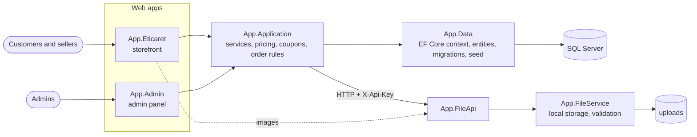

# Marketly

**English** · [Türkçe](README.tr.md)

A multi-seller marketplace for local producers: a storefront with cart, coupons and order tracking, a seller area, an admin panel and a small File API for product images.

[](https://github.com/Beratoguzhan620/marketly/actions/workflows/ci.yml)


## Demo accounts

Every account uses the password `Demo123!`.

| Role | E-mail | Where |
|---|---|---|
| Customer | `buyer@example.com` | storefront |
| Seller | `seller@example.com` | storefront (My products) |
| Admin | `admin@example.com` | admin panel |

Coupon codes to try at checkout: `HOSGELDIN10` (10% off, orders from 200 TL) and `BUYUKSEPET20` (20% off, orders from 750 TL).

The seed data has eight users, forty-plus products in nine categories, product reviews, six orders in different states and six blog posts.

## Features

**Storefront**

- **Catalogue:** home page, category listing with price and discount filters, sorting, paging and search; product pages with reviews and ratings.
- **Cart and checkout:**
  - Stock checks.
  - Per-product discounts, plus coupon codes for the whole cart (minimum total, validity window, usage limit).
  - A step indicator from cart to confirmation.
- **Orders:**
  - Numbers like `MK-2026-0007`.
  - Status shown to the customer: preparing → shipped → delivered, or cancelled.
- **Accounts:** registration, login, password reset with one-time links that expire after an hour; customers can apply to become sellers.
- **Sellers:** list, add and edit their own products with images.
- **Blog:** posts with category and tag filters; reader comments appear after approval.

**Admin panel**

- **Dashboard:** sales of the last twelve months (dependency-free SVG chart), pending work and recent orders.
- **Products, categories, users:** search, filters, paging and bulk actions.
- **Orders:** list and detail; move an order forward or cancel it, which puts the items back in stock.
- **Coupons:** create codes, enable or pause them, see usage.
- **Moderation:** seller applications, product reviews and blog comments.

**Under the hood**

- Every state change is a POST with an antiforgery token; irreversible actions ask for confirmation.
- Coupon usage is claimed in a single SQL statement, so two parallel checkouts cannot exceed the limit.
- Password reset tokens are stored only as SHA-256 hashes.
- Passwords are hashed with PBKDF2.
- Migrations and seed data are applied on start-up.

## Screenshots

| Category listing | Product |
|---|---|
|  |  |
| **Checkout with a coupon** | **Order status** |
|  |  |
| **Admin dashboard** | **Admin: orders** |
|  |  |

<p align="center"></p>

## Tech stack

- ASP.NET Core MVC on .NET 10: the storefront and the admin panel as two apps
- ASP.NET Core Web API for file uploads, protected with an API key
- Entity Framework Core 10 with SQL Server, code-first migrations and seed data
- Bootstrap 5 with a small custom design system ([docs/DESIGN.md](docs/DESIGN.md))
- xUnit with in-memory SQLite for service tests, Playwright for UI screenshots
- GitHub Actions: build with warnings as errors, tests, a pending-migration check, a Docker Compose smoke test and a UI preview on every pull request
- Docker / Docker Compose

## Architecture



Both web apps share one database and one service layer; each has its own cookie, so a storefront login does not open the admin panel. Product images go through the File API, which checks size, extension and content type before storing them.

## Running locally

### With Docker (one command)

```bash
git clone https://github.com/Beratoguzhan620/marketly.git
cd marketly
docker compose up --build
```

- Storefront: http://localhost:8080
- Admin panel: http://localhost:8081
- File API: http://localhost:8082

### With the .NET SDK

Requirements: .NET 10 SDK and SQL Server LocalDB (or set `ConnectionStrings:SqlServer`, see [docs/CONFIGURATION.md](docs/CONFIGURATION.md)).

```bash
dotnet run --project App/App.FileApi --launch-profile https    # https://localhost:7018
dotnet run --project App/App.Eticaret --launch-profile https   # https://localhost:7114
dotnet run --project App/App.Admin --launch-profile https      # https://localhost:7294
```

The Development settings already connect the apps to the File API. Without SMTP settings no e-mail is sent; in Development the password reset link is shown on the page.

## Tests

```bash
dotnet test
```

The service tests run against an in-memory SQLite database created from the real model and seed data. They cover:

- **Cart:** quantities, stock limits, products taken off sale, other users' carts.
- **Checkout:** order numbers, stock changes, rolling back when a product runs out.
- **Coupons:** minimum totals, dates, usage limits, rounding.
- **Order status:** allowed moves and restocking on cancel.
- **Password reset:** same answer for unknown addresses, hashed tokens, expiry, single use.

The UI preview workflow ([.github/workflows/ui-preview.yml](.github/workflows/ui-preview.yml)) starts both apps against a throwaway SQL Server, walks through the shopping and admin flows with Playwright at desktop and 360 px widths, and fails if a page scrolls sideways.

## Roadmap and known gaps

- Real payment provider (checkout is a demo; no money is taken).
- Product images stored in object storage instead of the File API's disk.

The full history of the rebuild is in [docs/ROADMAP.md](docs/ROADMAP.md).

## Background

This project started as a bootcamp project and was later rebuilt from the ground up. What changed:

- **Design:** the Ogani storefront theme and the SB Admin 2 panel were replaced by a single, consistent interface on a small design system, usable on phones.
- **Features:** paging and filters, coupons, order statuses, seller tools, password reset, a working blog, bulk admin actions and a sales dashboard.
- **Code:** hashed passwords and reset tokens, POST + antiforgery for every change, migrations instead of `EnsureCreated`, secrets out of the repository, one place for pricing rules.
- **Tests and CI:** service tests on SQLite, a pending-migration check, a Docker Compose smoke test and automated UI screenshots on every pull request.

## License

[MIT](LICENSE) · Berat Oğuzhan Turğut · [GitHub](https://github.com/Beratoguzhan620)
