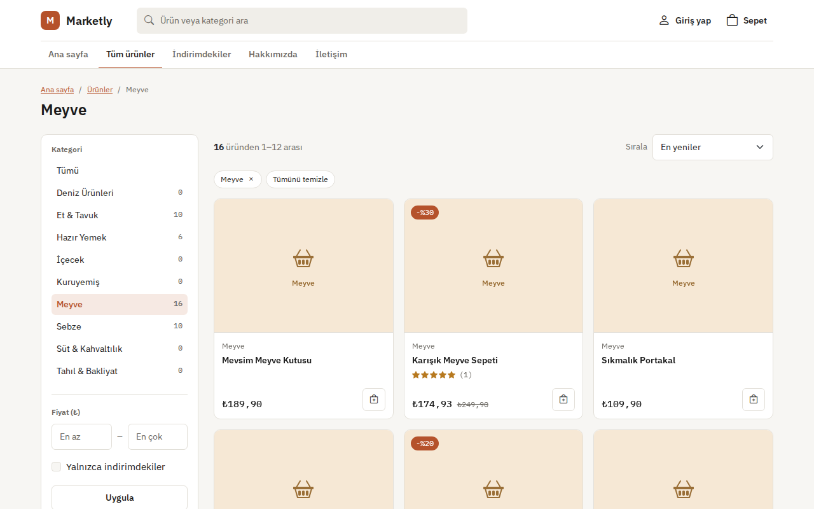
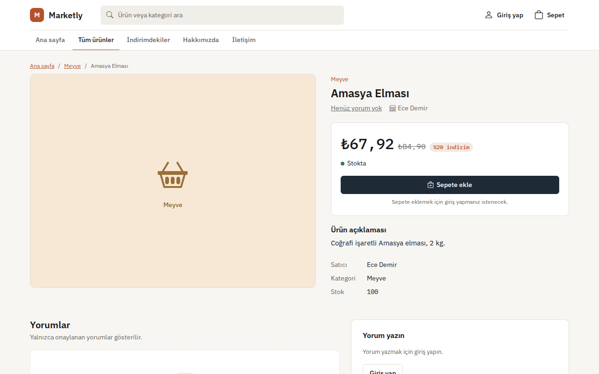
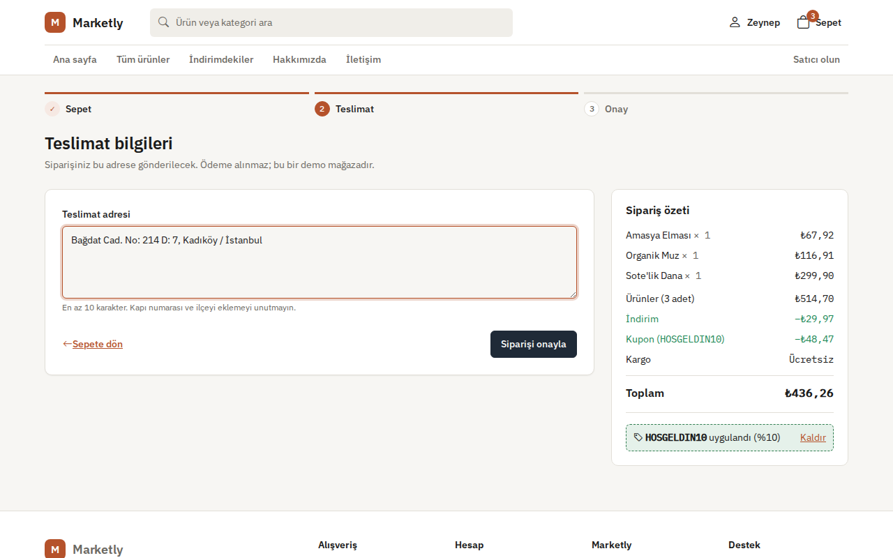
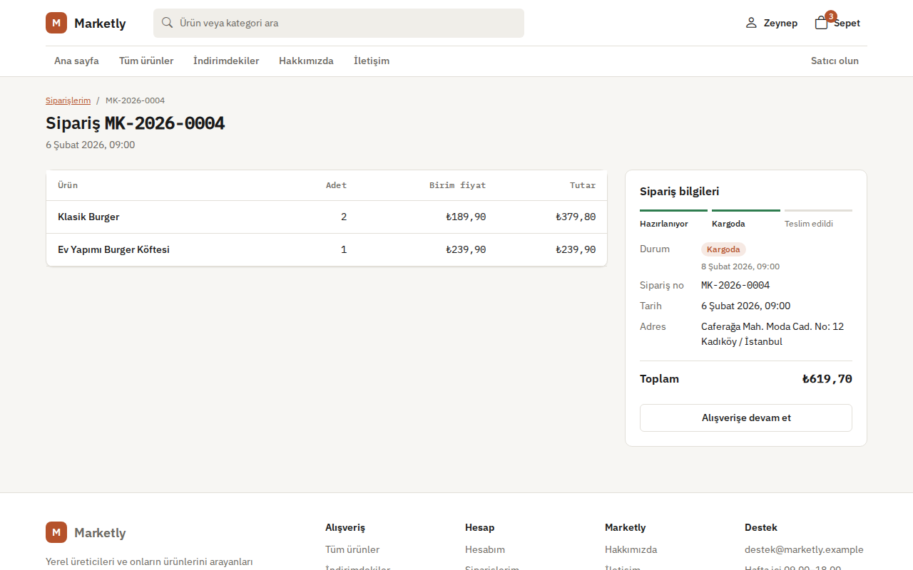
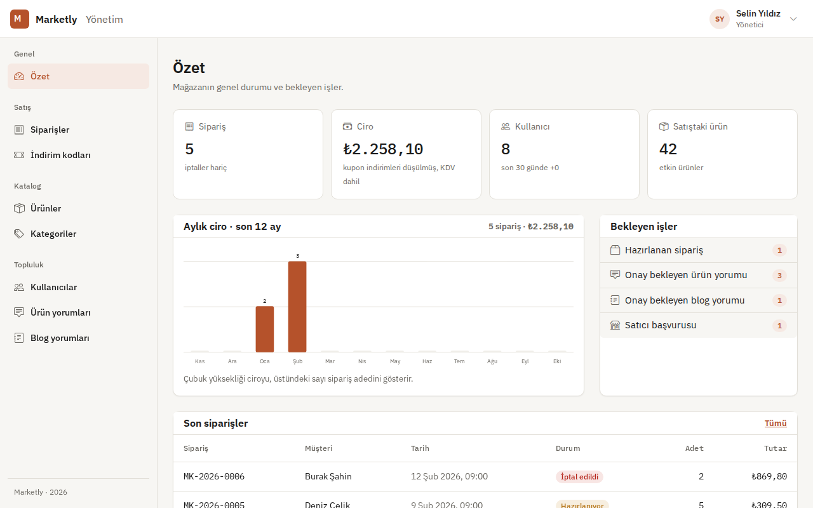
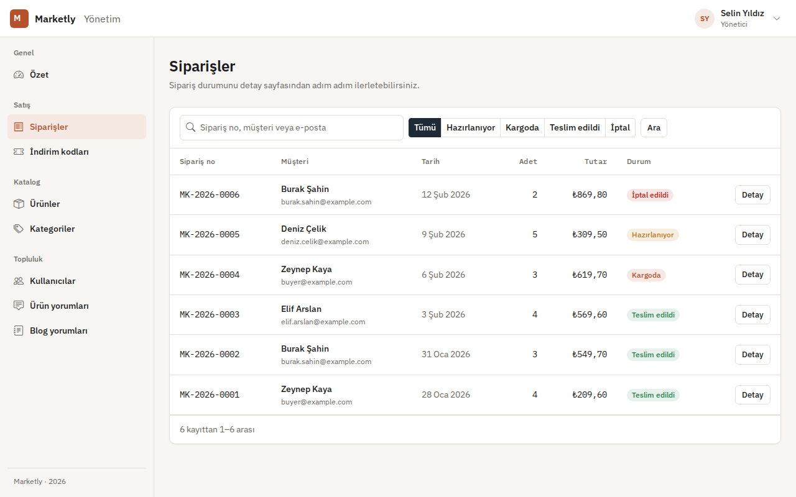
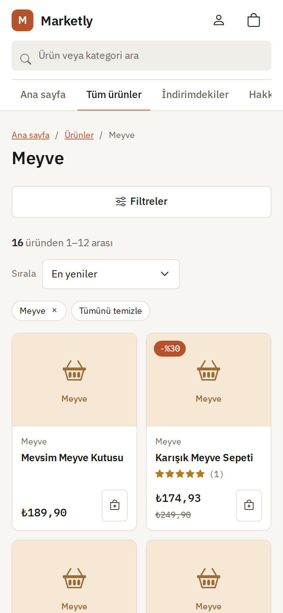
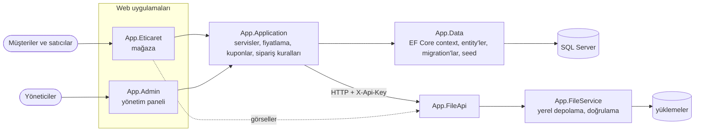

# Marketly

[English](README.md) · **Türkçe**

Yerel üreticiler için çok satıcılı pazar yeri: sepet, indirim kodu ve sipariş takibi olan bir mağaza, satıcı alanı, yönetim paneli ve ürün görselleri için küçük bir File API.

[](https://github.com/Beratoguzhan620/marketly/actions/workflows/ci.yml)


## Demo hesapları

Tüm hesapların şifresi `Demo123!`.

| Rol | E-posta | Nerede |
|---|---|---|
| Müşteri | `buyer@example.com` | mağaza |
| Satıcı | `seller@example.com` | mağaza (Ürünlerim) |
| Yönetici | `admin@example.com` | yönetim paneli |

Ödeme adımında denenebilecek kodlar: `HOSGELDIN10` (%10, 200 TL ve üzeri) ve `BUYUKSEPET20` (%20, 750 TL ve üzeri).

Seed verisinde sekiz kullanıcı, dokuz kategoride kırktan fazla ürün, ürün yorumları, farklı durumlarda altı sipariş ve altı blog yazısı var.

## Özellikler

**Mağaza**

- **Katalog:** ana sayfa; fiyat ve indirim filtreli, sıralamalı, sayfalı ve aramalı kategori listesi; yorum ve puanlı ürün sayfası.
- **Sepet ve ödeme:**
  - Stok kontrolü.
  - Ürün bazlı indirimler ve sepet geneli için indirim kodları (en az tutar, geçerlilik tarihi, kullanım limiti).
  - Sepetten onaya adım göstergesi.
- **Siparişler:**
  - `MK-2026-0007` biçiminde numaralar.
  - Müşteriye gösterilen durum: hazırlanıyor → kargoda → teslim edildi ya da iptal.
- **Hesaplar:** kayıt, giriş, bir saat geçerli ve tek kullanımlık bağlantıyla şifre sıfırlama; müşteriler satıcı olmak için başvurabilir.
- **Satıcılar:** kendi ürünlerini görselleriyle listeler, ekler ve düzenler.
- **Blog:** kategori ve etiket filtreli yazılar; okur yorumları onaydan sonra görünür.

**Yönetim paneli**

- **Özet ekranı:** son on iki ayın satışları (bağımlılıksız SVG grafik), bekleyen işler ve son siparişler.
- **Ürünler, kategoriler, kullanıcılar:** arama, filtre, sayfalama ve toplu işlemler.
- **Siparişler:** liste ve detay; siparişi bir sonraki duruma geçirme ya da iptal etme (iptalde ürünler stoğa döner).
- **İndirim kodları:** kod oluşturma, etkinleştirme veya durdurma, kullanımları görme.
- **Denetim:** satıcı başvuruları, ürün yorumları ve blog yorumları.

**Arka planda**

- Durum değiştiren her işlem antiforgery korumalı POST; geri alınamayan işlemler onay ister.
- İndirim kodu kullanımı tek bir SQL komutuyla düşülür; aynı anda verilen iki sipariş limiti aşamaz.
- Şifre sıfırlama token'ları yalnızca SHA-256 özetiyle saklanır.
- Şifreler PBKDF2 ile hash'lenir.
- Migration ve seed verisi açılışta uygulanır.

## Ekran görüntüleri

| Kategori listesi | Ürün |
|---|---|
|  |  |
| **İndirim kodlu ödeme** | **Sipariş durumu** |
|  |  |
| **Yönetim: özet** | **Yönetim: siparişler** |
|  |  |

<p align="center"></p>

## Teknolojiler

- .NET 10 üzerinde ASP.NET Core MVC: mağaza ve yönetim paneli iki ayrı uygulama
- Dosya yüklemeleri için API anahtarıyla korunan ASP.NET Core Web API
- Entity Framework Core 10 + SQL Server, code-first migration'lar ve seed verisi
- Küçük bir tasarım sistemiyle Bootstrap 5 ([docs/DESIGN.md](docs/DESIGN.md))
- Servis testleri için xUnit + bellek içi SQLite, arayüz görüntüleri için Playwright
- GitHub Actions: her pull request'te uyarıların hata sayıldığı build, testler, eksik migration kontrolü, Docker Compose duman testi ve arayüz önizlemesi
- Docker / Docker Compose

## Mimari



İki web uygulaması aynı veritabanını ve servis katmanını paylaşır; her birinin kendi çerezi vardır, mağazada oturum açmak paneli açmaz. Ürün görselleri File API üzerinden yüklenir; API boyutu, uzantıyı ve içerik türünü kontrol ettikten sonra dosyayı saklar.

## Yerelde çalıştırma

### Docker ile (tek komut)

```bash
git clone https://github.com/Beratoguzhan620/marketly.git
cd marketly
docker compose up --build
```

- Mağaza: http://localhost:8080
- Yönetim paneli: http://localhost:8081
- File API: http://localhost:8082

### .NET SDK ile

Gerekenler: .NET 10 SDK ve SQL Server LocalDB (ya da `ConnectionStrings:SqlServer` ayarı; bkz. [docs/CONFIGURATION.md](docs/CONFIGURATION.md)).

```bash
dotnet run --project App/App.FileApi --launch-profile https    # https://localhost:7018
dotnet run --project App/App.Eticaret --launch-profile https   # https://localhost:7114
dotnet run --project App/App.Admin --launch-profile https      # https://localhost:7294
```

Development ayarları uygulamaları File API'ye zaten bağlar. SMTP ayarı yoksa e-posta gönderilmez; Development ortamında şifre sıfırlama bağlantısı sayfada gösterilir.

## Testler

```bash
dotnet test
```

Servis testleri gerçek model ve seed verisinden oluşturulan bellek içi SQLite veritabanında çalışır. Kapsadıkları:

- **Sepet:** adet, stok sınırı, satıştan kalkan ürün, başkasının sepeti.
- **Ödeme:** sipariş numaraları, stok değişimi, ürün tükenince geri alma.
- **İndirim kodları:** en az tutar, tarihler, kullanım limiti, yuvarlama.
- **Sipariş durumu:** izin verilen geçişler ve iptalde stoğa iade.
- **Şifre sıfırlama:** kayıtsız adrese aynı cevap, hash'lenmiş token, süre sonu, tek kullanım.

UI preview iş akışı ([.github/workflows/ui-preview.yml](.github/workflows/ui-preview.yml)) iki uygulamayı geçici bir SQL Server ile başlatır, alışveriş ve yönetim akışlarını Playwright ile masaüstü ve 360 px genişlikte dolaşır ve yatay kaydırma olan sayfada hata verir.

## Yol haritası ve bilinen eksikler

- Gerçek ödeme altyapısı (ödeme adımı demodur, para alınmaz).
- Ürün görsellerinin File API'nin diski yerine nesne depolamada tutulması.

Yeniden yapımın tüm aşamaları: [docs/ROADMAP.md](docs/ROADMAP.md).

## Proje geçmişi

Bu proje bir bootcamp projesi olarak başladı, sonra baştan geliştirildi. Neler değişti:

- **Tasarım:** Ogani mağaza teması ve SB Admin 2 paneli yerine, küçük bir tasarım sistemine dayanan, telefonda da rahat kullanılan tek ve tutarlı bir arayüz.
- **Özellikler:** sayfalama ve filtreler, indirim kodları, sipariş durumları, satıcı araçları, şifre sıfırlama, çalışan bir blog, toplu yönetim işlemleri ve satış özeti.
- **Kod:** hash'lenmiş şifreler ve sıfırlama token'ları, her değişiklikte POST + antiforgery, `EnsureCreated` yerine migration'lar, repodan çıkarılan gizli bilgiler, fiyat kuralları için tek bir yer.
- **Test ve CI:** SQLite üzerinde servis testleri, eksik migration kontrolü, Docker Compose duman testi ve her pull request'te otomatik arayüz görüntüleri.

## Lisans

[MIT](LICENSE) · Berat Oğuzhan Turğut · [GitHub](https://github.com/Beratoguzhan620)
